# DossierGraph: AI pre-scrutiny for AICTE approval dossiers

**SIH 2026 · Problem Statement SIH26261** · *AI-Powered Application Validation, Document Authentication and Regulatory Compliance Verification* · Team **CITADEL**

DossierGraph checks an institution's whole approval dossier before a human scrutiny officer reads it:

- every document against its **issuing authority** (digital signature, QR code, issuer registry);
- every document against the **AICTE Approval Process Handbook (APH) 2024-27**, with 20 rules that each cite their clause;
- every document against **every other document**: land deed ↔ land-use certificate ↔ building plan ↔ occupancy certificate ↔ fire certificate ↔ Affidavit 2 ↔ faculty roster.

Officers get a ranked queue and a findings list in which every finding is linked to evidence. **The system never decides.** Adverse outcomes need a second, senior officer to approve them.

> **Status:** working prototype, measured on 200 labelled synthetic dossiers (2,281 documents). All data is synthetic; no real institution, person or document is used (see [Test documents](#test-documents)).

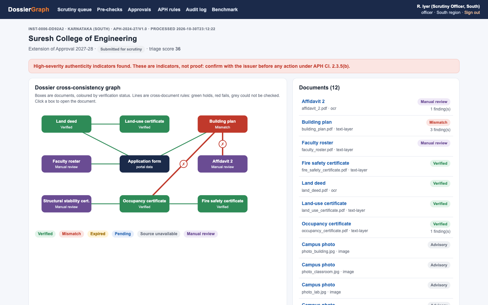

---

## Contents

1. [Quick start](#quick-start)
2. [Five-minute demo](#five-minute-demo)
3. [What is built](#what-is-built)
4. [Architecture](#architecture)
5. [How a dossier is processed](#how-a-dossier-is-processed)
6. [Test documents](#test-documents)
7. [The 8 forgery types and how each is caught](#the-8-forgery-types-and-how-each-is-caught)
8. [APH rule pack](#aph-rule-pack)
9. [Trust layer (security and privacy)](#trust-layer-security-and-privacy)
10. [Benchmark results](#benchmark-results)
11. [Tests](#tests)
12. [Prototype vs production](#prototype-vs-production)
13. [Known limitations and next steps](#known-limitations-and-next-steps)
14. [Repository layout](#repository-layout)
15. [Team work split](#team-work-split)

---

## Quick start

You need **macOS or Linux, Python 3.11 to 3.13 and Tesseract OCR**. On a Mac: `brew install tesseract`; on Ubuntu: `sudo apt install tesseract-ocr`.

```bash
cd prototype
python3 -m venv .venv && source .venv/bin/activate
pip install -r requirements.txt
python -m dossiergraph.cli seed          # makes 16 demo dossiers, test users and processes them (~50 s)
uvicorn dossiergraph.app:app --port 8000
```

Open <http://localhost:8000>. The test accounts are in `prototype/seed_users.yaml` and are local only:

| Account | Role | Sees |
|---|---|---|
| `officer.south` / `officer.west` / `officer.north` | Scrutiny officer | Only their region's applications |
| `senior` | Senior officer | All regions; the only role that approves adverse outcomes |
| `admin` | Administrator | Rules, audit log, benchmark; cannot decide applications |
| `inst-0001` … `inst-0016` | Institution | Only its own applications and its own access log |

Other commands:

```bash
python -m pytest -q                                   # 14 tests, ~30 s
python -m bench.run_benchmark --n 200 --seed 2026     # full benchmark, ~7 min
python -m synth.generate --set mine --n 50 --seed 7   # generate more labelled dossiers
python -m dossiergraph.cli verify-audit               # check the audit hash chain
python -m dossiergraph.cli tamper-audit               # edit one audit row directly in SQLite, then watch verification fail
```

---

## Five-minute demo

**Step 1: Queue.** Sign in as `officer.south`. The queue is ordered by an explainable triage score, and every score lists its top contributing factors. The officer sees the South region only.

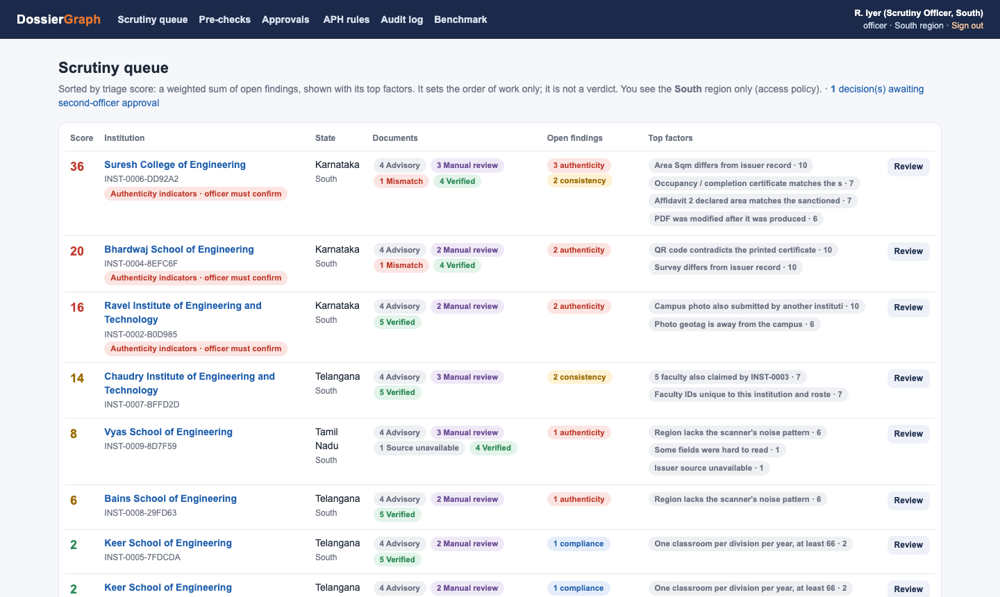

**Step 2: Dossier graph.** Open *Suresh College of Engineering*. The building plan is red: its sanctioned area was edited after issue. The graph shows the contradiction spreading to the occupancy certificate and Affidavit 2, which no longer agree with the plan.

**Step 3: Evidence.** Scroll to the findings. Each one shows the APH clause, a watermarked crop of the exact field, and the next step. Officers accept a finding, override it with a written reason, or escalate it.

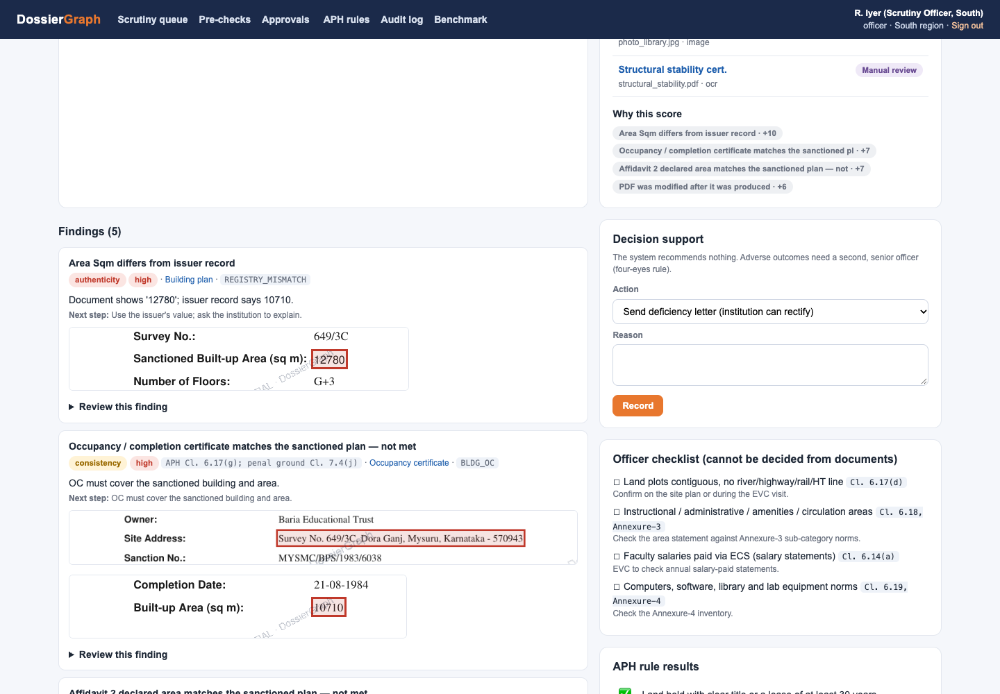

**Step 4: Document view.** Click the building plan. The issuer registry disagrees on the area, the PDF has an extra revision, and the edited value is set in a different font. The page is rendered on the server and watermarked with the viewer's name and the time; the original file never reaches the browser.

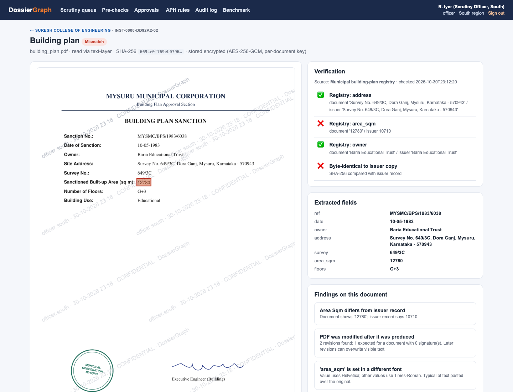

**Step 5: Four-eyes rule.** Propose *Refer under Cl. 2.3.5(b)* with a reason. An officer cannot approve it, and a senior officer cannot approve their own proposal. Sign in as `senior` to approve it.

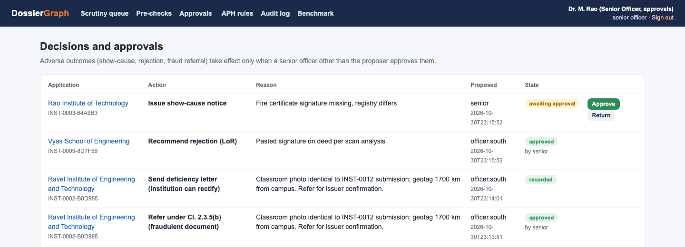

**Step 6: Institution side.** Sign in as `inst-0005`. Run a pre-check: the same engine flags the classroom shortfall before the application is submitted. *Who viewed my records* lists every officer view of the institution's records.

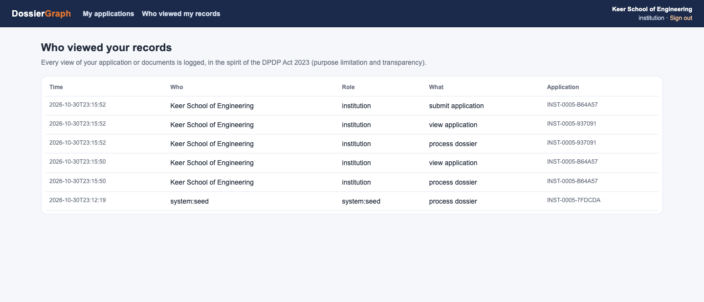

**Step 7: Tamper-evident log.** As `admin`, open *Audit log* and see the chain verified. Run `python -m dossiergraph.cli tamper-audit` and reload: the break is pinpointed.

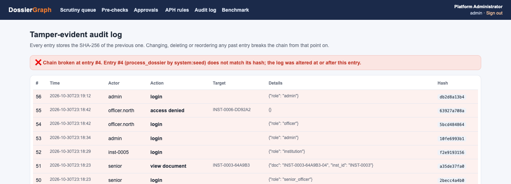

---

## What is built

| Feature (from the idea deck) | Module | Status |
|---|---|---|
| Category checklist and missing-document detection | `pipeline.py` (`REQUIRED`) | ✅ Built |
| OCR + document classification + field extraction with page coordinates | `extract.py` (PyMuPDF text layer, Tesseract OCR) | ✅ Built |
| Issuer verification: digital signatures | `verify.py` (pyHanko, test PKI in `pki.py`) | ✅ Built (real PAdES validation against a test root) |
| Issuer verification: QR codes | `verify.py` + OpenCV QR decoder | ✅ Built |
| Issuer verification: registries (DigiLocker-style pull, municipal, land, fire) | `verify.py` `Registry` | 🟡 Mock registries with real adapter logic |
| 6 verification statuses (verified, mismatch, expired, pending, source unavailable, manual review) | `verify.py` | ✅ Built |
| Dossier cross-consistency graph | `pipeline.py` (graph) + `templates/app.html` (SVG) | ✅ Built |
| 20 APH 2024-27 rules as code with clause citations + bilingual (EN/HI) deficiency notes | `rules/aph_2024_27.yaml` + `rules/__init__.py` | ✅ Built (15 automated, 5 officer-checklist) |
| PDF forensics: extra revisions, font inconsistency, edits after signing | `forensics.py`, `verify.py` | ✅ Built |
| Scan forensics: pasted seal or signature (noise floor + ELA) | `forensics.py` | ✅ Built |
| Photo reuse across institutions (pHash + ORB keypoint verification + 256-bit dHash) and EXIF GPS vs campus | `forensics.py`, `pipeline.py` | ✅ Built |
| Ghost-faculty detection via keyed-hash (HMAC) matching across institutions | `crypto.py`, `pipeline.py` | ✅ Built |
| Officer workstation: queue, explainable score, evidence crops, accept / override / escalate | `app.py`, templates | ✅ Built |
| Official PDF Scrutiny & EVC Physical Verification Note export | `viewer.py` (`scrutiny_pdf`), `app.py` | ✅ Built |
| Four-eyes approval for adverse outcomes | `access.py`, `app.py` | ✅ Built |
| Institution pre-check portal and submission (isolated from cross-institution tables until submitted) | `app.py` `/portal`, `pipeline.py` | ✅ Built |
| Tamper-evident audit log | `db.py` | ✅ Built |
| Envelope encryption per document; secure watermarked viewing | `crypto.py`, `viewer.py` | ✅ Built |
| Role- and region-based access; DPDP-style access log for institutions | `access.py`, `/portal/access-log` | ✅ Built |
| Upload hardening: type sniffing, size limit, active-content detection, antivirus hook | `intake.py` | ✅ Built (ClamAV is used if installed) |
| Synthetic forgery benchmark with measured precision and recall | `synth/`, `bench/` | ✅ Built |
| Interactive rule builder & dry-run simulator on past applications | `rules/__init__.py` (`dry_run`), `/rules/dry-run` | ✅ Built |
| Hindi / Devanagari field labels, numeral normalisation, and bilingual deficiency guidance | `extract.py`, `rules/aph_2024_27.yaml` | ✅ Built |
| Remote EVC capture mobile app | — | ⏭ Roadmap (printable EVC verification note is built) |

---

## Architecture

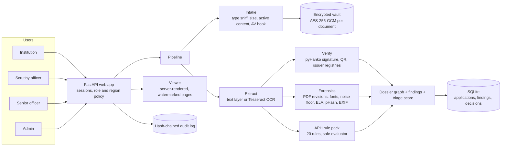

## How a dossier is processed

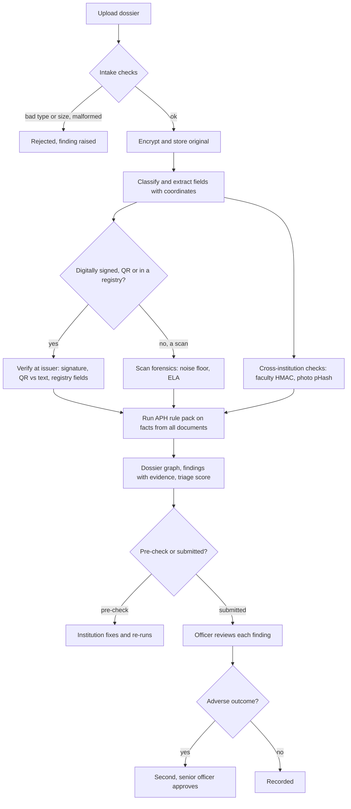

Every step writes to the hash-chained audit log.

---

## Test documents

The problem statement asks for **authorized, anonymised or synthetic datasets**, and real institutional dossiers contain personal data covered by the DPDP Act. So the prototype ships a generator (`synth/`) that produces realistic **synthetic** dossiers; every person and institution is fictitious. The demo set lives in `prototype/data/samples/demo/` (16 institutions, about 13 files each):

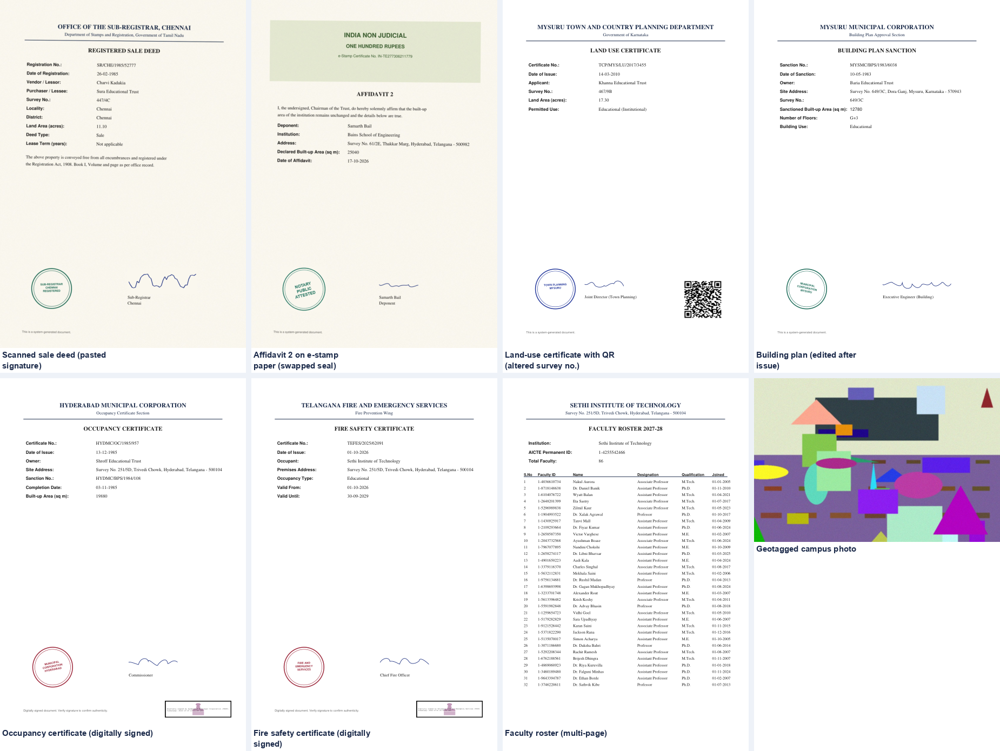

| Document | Format | How it is verified |
|---|---|---|
| Registered sale or lease deed | Scanned PDF (tinted paper, noise, slight skew) | Land-records registry (state-dependent: available, pending or unavailable); scan forensics |
| Land-use certificate | Digital PDF with QR code | QR payload vs printed text; Town Planning registry |
| Building plan sanction | Digital PDF | Municipal registry; PDF revision and font forensics |
| Occupancy certificate | **Digitally signed** PDF (PAdES, test CA) | Signature validation, including edits after signing; municipal registry |
| Fire safety certificate | **Digitally signed** PDF | Signature, expiry against the academic year, address; fire-services registry |
| Structural stability certificate | Scanned PDF (only for buildings older than 30 years) | Manual review; scan forensics |
| Affidavit 2 | Scanned on e-stamp paper with notary seal | Manual review; scan forensics; area vs building plan |
| Faculty roster | Multi-page digital PDF | 1:20 / 1:25 ratios; cross-institution HMAC matching |
| Campus photos (4) | JPEG with EXIF GPS | Perceptual-hash reuse; GPS vs campus |
| `application.json` | Portal form data | Source of declared intake, address, classrooms and GPS |

**Using your own documents:** sign in as an institution and upload PDFs or JPEGs in *Run a pre-check*; uploads replace files of the same name. Documents from unknown issuers fall back to *manual review*. Real registries (DigiLocker requester APIs, state portals) need authorisation from the issuing agencies; `verify.Registry` is the adapter boundary where they plug in.

---

## The 8 forgery types and how each is caught

| # | Forgery (as generated) | Main signals | Benchmark recall |
|---|---|---|---|
| 1 | **Altered date**: fire-certificate expiry extended, either edited after signing or retyped unsigned | Signature covers an earlier revision, or an expected signature is missing; registry mismatch | 10/10 |
| 2 | **Altered identifier**: land-use certificate issued for another parcel, survey number retyped | QR contradicts the printed text; registry mismatch | 10/10 |
| 3 | **Swapped seal**: notary seal on Affidavit 2 replaced by a pasted image | Noise-free region in the scan; ELA peak | 10/10 |
| 4 | **Pasted signature** on the scanned deed | Noise-free region in the scan | 10/10 |
| 5 | **PDF text edit**: sanctioned area raised via an incremental save | Extra PDF revision; value in a different font; registry mismatch; cross-document rules fail | 10/10 |
| 6 | **Photo reuse**: classroom photo copied from another institution | pHash distance ≤ 8 to the other institution's photo; GPS 100s of km from campus | 10/10 |
| 7 | **Faculty double-claim**: faculty IDs also on another institution's roster | HMAC token collision (raw IDs are never compared or shown) | 10/10 |
| 8 | **Cross-document inconsistency**: Affidavit 2 declares 15–30% more area than the plan | `BUA_AFFIDAVIT2` rule (2% tolerance) | 10/10 |

Forensic signals are **indicators**, never proof. The UI and the audit trail say so, and the final call is always the officer's.

---

## APH rule pack

`prototype/dossiergraph/rules/aph_2024_27.yaml`. Clause numbers were checked against the official APH 2024-25 to 2026-27 text.

| Rule | Clause | Check |
|---|---|---|
| LAND_TITLE · LAND_LIVE_LEASE · LAND_DEED_TYPE | Cl. 6.17(a), (b) | Sale deed or lease ≥ 30 years; remaining lease ≥ longest programme; registered deed |
| LAND_USE_CERT | Cl. 6.17(e) | Land-use certificate names the deed's survey number |
| BLDG_PLAN_MATCH · BLDG_OC | Cl. 6.17(f), (g); 7.4(j) | Plan is for this site; OC matches plan address and area |
| BLDG_STRUCT_STAB | Cl. 6.17(h) | Building > 30 years old ⇒ stability certificate ≤ 5 years old |
| BLDG_FIRE | Cl. 6.17(i) | Fire certificate valid on 1 July 2027 and issued for the plan's address |
| AUTHORITY_VALID | Cl. 6.17(j), Annex-14 | Issuer is a competent authority (list mocked) |
| BUA_CLASSROOMS · BUA_AFFIDAVIT2 | Annex-3; Affidavit 2, Cl. 6.39 | One classroom ≥ 66 m² per division-year; declared area within 2% of plan |
| FAC_RATIO_UG · FAC_RATIO_DIP · FAC_ID_UPDATE | Cl. 6.14, Annex-5; 6.14(c) | 1:20 UG, 1:25 diploma; no faculty claimed elsewhere; roster count consistent |
| FRAUD_ESCALATE | Cl. 2.3.5(b) | No unresolved high-severity authenticity indicators |
| 5 officer-checklist rules | 6.17(d), 6.18, 6.14(a), 6.19, Joint Affidavit 7 | Cannot be decided from documents, so listed for the officer / EVC |

Rules use a small expression language parsed with Python's `ast`, with a whitelist of functions. Nothing is passed to `eval`, and private attributes are rejected (both covered by tests). If a fact is missing, the rule is marked **undetermined** and sent to the officer; it never silently passes. Each application stores the rule-pack version it was checked against.

---

## Trust layer (security and privacy)

| Control | Implementation in the prototype |
|---|---|
| Encryption at rest | Each document has its own random AES-256-GCM key, wrapped by a master key (`data/keys/master.key`). Ciphertext is bound to the document ID, so swapping files fails to decrypt. |
| Secure viewing | Originals are never sent to the browser. Pages are rasterised on the server (which disarms embedded JavaScript and actions), outlined where there is evidence, and watermarked with the viewer and time. Responses are `no-store`. |
| Access control | Session login (scrypt password hashes). Policy in `access.py`: institutions see their own records only, officers their region only, admins cannot decide. Denials are audited. |
| Four-eyes rule | Show-cause, rejection and fraud referral take effect only after a *different* senior officer approves. Enforced on the server and covered by tests. |
| Privacy-preserving matching | Faculty IDs are compared as HMAC-SHA256 tokens under a secret key. Institutions are told only "another institution", never which one. |
| Tamper-evident audit log | Each entry hashes the previous one; `verify_audit` pinpoints the first altered entry. Logins, views, reviews, decisions and denials are all logged. |
| DPDP transparency | Institutions see who viewed their records and when. |
| Upload hardening | Magic-byte type check, 15 MB limit, malformed-PDF rejection, detection of `/JavaScript`, `/OpenAction`, `/Launch`, `/EmbeddedFiles` and similar, and an optional ClamAV scan. |
| No third-party AI | All processing is local: Tesseract, OpenCV and pyHanko. No document leaves the machine. |
| Human oversight | Findings are labelled as indicators. Overrides require a reason. The system never issues an outcome. |

---

## Benchmark results

`python -m bench.run_benchmark --n 200 --seed 2026`. Results are in `prototype/bench/results.json` and on the in-app *Benchmark* page.

- **Data:** 200 synthetic dossiers, 2,281 documents. 80 contain one forgery (10 of each type), 23 have genuine compliance gaps, and 106 are fully genuine.
- **Method:** thresholds were tuned on *different* seeds (5, 9 and 77), and the benchmark seed was never used for tuning.

| Metric | Result |
|---|---|
| Forgeries detected (recall) | **80 / 80 (100%)**, 10/10 for every type |
| Authenticity-flag precision | **91.7%** (133 flags) |
| Consistency-flag precision | **85.7%** (84 flags) |
| False flags per genuine dossier | **0.198**; 12.3% of genuine dossiers had at least one |
| Compliance-gap recall | **100%** (23 / 23) |
| Field extraction accuracy | **100%** text layer (1,340 fields) · **96.9%** OCR (1,191 fields) |
| Processing time | **1.9 s** mean per dossier, 2.3 s p95 (single laptop process) |

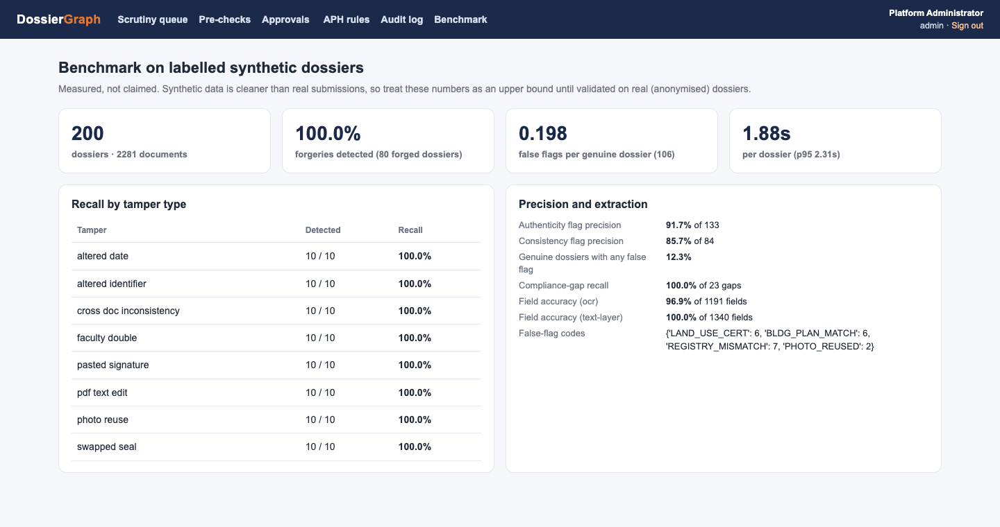

**Where it went wrong (all false flags on genuine dossiers):**

13 of the 106 genuine dossiers got at least one false flag:

- **11 were OCR misreads on scanned land deeds**, for example `7.35` read as `1.35`, or a `/` dropped from a survey number. A misread deed survey number then also fails the two cross-document land rules. One-character slips are already downgraded to "possible OCR misread"; larger misreads are not.
- **2 were one pair of genuine building photos** at a perceptual-hash distance of exactly 8, the threshold.

**Read these numbers carefully.** Synthetic forgeries are cleaner and more uniform than real ones, so 100% recall here is an **upper bound**, not a promise. Real scans will be noisier, so expect lower OCR accuracy and more false flags. The next step is validation on authorised, anonymised real dossiers.

---

## Tests

`python -m pytest -q` runs 14 tests (about 30 s) on an isolated data folder:

- **Encryption:** encryption round-trip, tamper detection, and the ciphertext's binding to its document ID.
- **Keyed hashing:** HMAC faculty tokens are normalised and never contain the raw ID.
- **Audit log:** the chain detects an edited row and pinpoints it.
- **Access policy:** role and region rules; the four-eyes rule blocks an officer and a self-approving senior.
- **Passwords:** scrypt password hashing.
- **Intake:** rejects a disguised executable and detects a JavaScript `/OpenAction`.
- **Rule language:** rejects `__import__`, lambdas, `open()` and private attributes; evaluates rules; marks a missing fact as *undetermined*.
- **End to end:** one dossier per forgery type is generated and processed, and every type is caught. The audit chain stays intact and stored documents are encrypted.

---

## Prototype vs production

| Concern | Prototype | Production target (from the idea deck) |
|---|---|---|
| Web UI | Server-rendered FastAPI + Jinja (no build step) | Next.js workstation |
| Database | SQLite | PostgreSQL |
| Object store | Encrypted files in `data/vault/` | MinIO (S3-compatible), on government infrastructure |
| Keys | Local master key file | HashiCorp Vault transit (key rotation, HSM) |
| Identity | Built-in login and policy functions | Keycloak (MFA) + OPA policies |
| Background jobs | In-process | Celery + Redis workers |
| OCR | Tesseract (English) | PaddleOCR / Tesseract with Hindi and regional models |
| Issuer sources | Mock registries; real signature and QR checks | DigiLocker requester APIs, state portals (needs MoUs) |
| PKI | Self-made **TEST** root CA | CCA-licensed certificate chains |
| Antivirus | Optional ClamAV | ClamAV / enterprise AV |

---

## Known limitations and next steps

1. **OCR on real scans.** Add 300-dpi re-scan guidance, image clean-up and an OCR ensemble. Treat low-confidence numeric fields as *manual review* rather than mismatch.
2. **Perceptual hashing alone** can collide on similar buildings. Add a second check (ORB keypoint matching) before raising a high-severity reuse flag.
3. **Forgery realism.** Add harder forgeries (copy-move inside one scan, full re-typesetting with matching fonts, printed-and-rescanned edits) and validate on real anonymised dossiers.
4. **No-code rule builder** with a dry run on past applications ("this change would flag 37 more"), and approval of rule changes by a second admin.
5. **Annexure-3 / Annexure-14 tables:** the built-up-area sub-categories and the state-wise competent authorities still need to be transcribed in full.
6. **Real connectors:** DigiLocker requester (OAuth + PKCE, India-hosted), state fire and land portals, and the AICTE faculty registry.
7. **Hardening:** CSRF tokens, rate limiting, HTTPS, key rotation, and data-retention jobs.

---

## Repository layout

```
SIH 2026/
├── README.md                     this file (PDF copy: docs/DossierGraph_README.pdf)
├── SIH26261_Feature_Plan.md/.pdf  feature plan and idea-submission plan
├── Deck/                          idea-submission decks (PPTX + PDF)
├── reports/, research_notes/      SIH research and evaluation
├── docs/screenshots/              screenshots used in this README
└── prototype/
    ├── dossiergraph/              the application
    │   ├── app.py                 web routes (portal, queue, workstation, approvals, audit)
    │   ├── pipeline.py            end-to-end dossier processing, graph, score
    │   ├── extract.py             classification, text layer, OCR, field extraction
    │   ├── verify.py              signatures, QR, issuer registries, statuses
    │   ├── forensics.py           PDF, scan and photo forensics
    │   ├── rules/                 APH rule pack (YAML) + safe evaluator
    │   ├── crypto.py · access.py · db.py · intake.py · viewer.py · pki.py
    │   └── templates/, static/
    ├── synth/                     synthetic document and forgery generator
    ├── bench/                     benchmark runner + results.json
    ├── tests/                     pytest suite
    ├── tools/screenshots.py       regenerates README screenshots
    ├── seed_users.yaml            TEST accounts (local only)
    └── data/samples/demo/         16 demo dossiers (keys, vault and databases are not committed)
```

## Team work split

| Track | Owns | Start here |
|---|---|---|
| OCR and extraction | Better OCR, Hindi, field schemas | `extract.py`, benchmark field accuracy |
| Rules engine | Annexure tables, rule builder, dry run | `rules/`, `pipeline.py` |
| Forensics and computer vision | ORB photo matching, copy-move, harder forgeries | `forensics.py`, `synth/` |
| Verification adapters | DigiLocker / state portal adapters | `verify.py` `Registry` |
| Trust layer | Keycloak/OPA, Vault, CSRF, retention | `access.py`, `crypto.py`, `db.py` |
| Frontend and demo | Next.js port, demo video, deck screenshots | `templates/`, `tools/screenshots.py` |

---

*All outputs are decision support. Statutory scrutiny, inspections and final regulatory decisions remain with the competent AICTE authorities. All data in this repository is synthetic.*
