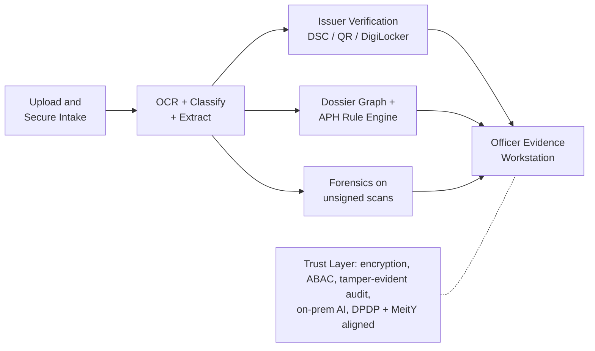
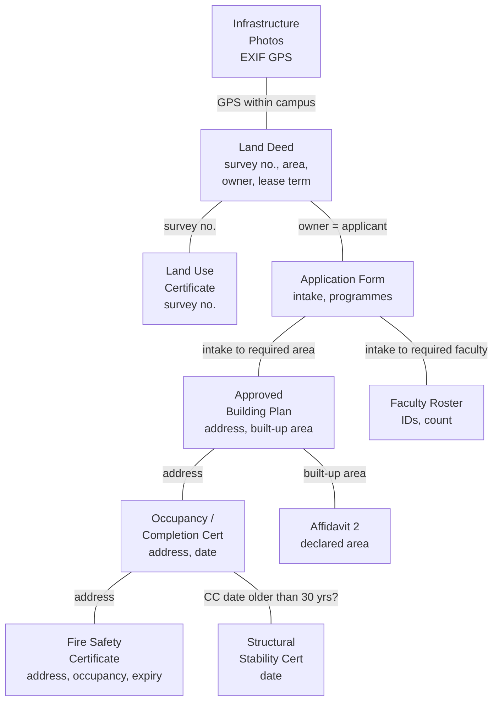
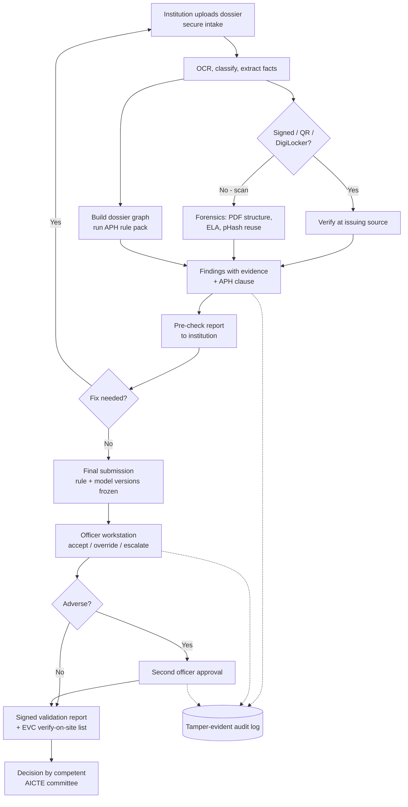

# SIH26261 — Idea Submission & Presentation Plan (v2)

**Problem Statement:** SIH26261 · *AI-Powered Application Validation, Document Authentication and Regulatory Compliance Verification* · AICTE, Ministry of Education

**Theme / Category:** Smart Education · Software

> **One-line pitch:** "The only SIH26261 solution that *proves* it works — measured forgery-detection accuracy on a labelled benchmark, real APH 2024-27 rules with clause citations, and dossier-level cross-checks that no KYC tool does."

---

## Why v2 is different

The evaluation found that the visible SIH26261 field (≈23 public repos) already ships forensics, APH rules, issuer mocks, photo-reuse checks and human-in-the-loop review. Those are **table stakes**. Judges screen a 6-slide PDF without us in the room, so the deck must lead with what others **cannot show**:

| # | Change | Where it lands in the deck |
|---|---|---|
| 1 | **Benchmark is the headline** — measured precision/recall on a labelled synthetic forgery set | Slides 2, 4, 5 |
| 2 | **Real APH 2024-27 rules** with clause numbers (no placeholders) | Slides 2, 3, 6 |
| 3 | **Dossier cross-consistency graph** — land deed ↔ building plan ↔ OC ↔ fire certificate ↔ declared area ↔ faculty | Slide 2 (hero visual) |
| 4 | **Security condensed into one "Trust Layer"** mapped to DPDP + MeitY AI Guidelines | Slide 3 (one box) |
| 5 | **Defined 36-hour MVP** — what we build vs. what is roadmap | Slide 4 |

---

## Contents

**Part A — The 6-slide idea submission**
1. [Slide 1 — Title](#slide-1--title)
2. [Slide 2 — Proposed Solution](#slide-2--proposed-solution)
3. [Slide 3 — Technical Approach](#slide-3--technical-approach)
4. [Slide 4 — Feasibility & Viability](#slide-4--feasibility--viability)
5. [Slide 5 — Impact & Benefits](#slide-5--impact--benefits)
6. [Slide 6 — Research & References](#slide-6--research--references)

**Part B — Supporting detail (for the team, Q&A and the finale)**

- 7\. [The Benchmark (headline)](#7-the-benchmark--our-headline)
- 8\. [APH 2024-27 Rule Pack](#8-aph-2024-27-rule-pack-v1)
- 9\. [Dossier Cross-Consistency Graph](#9-dossier-cross-consistency-graph)
- 10\. [Trust Layer](#10-trust-layer-security--privacy-condensed)
- 11\. [36-Hour MVP Scope](#11-36-hour-mvp-scope)
- 12\. [Process Flow](#12-process-flow)
- 13\. [Differentiation vs. the Field](#13-differentiation-vs-the-sih26261-field)
- 14\. [Deck Design Rules & Checklist](#14-deck-design-rules--submission-checklist)
- 15\. [Work Split](#15-work-split-presentation-first)

---

# Part A — The 6-Slide Idea Submission

Official template: **max 6 slides including title, PDF, points and diagrams — no paragraphs.** Every slide below lists the *exact content*, the *one visual*, and what *not* to put on it.

## Slide 1 — Title

| Field | Content |
|---|---|
| Problem Statement ID | **SIH26261** |
| PS Title | AI-Powered Application Validation, Document Authentication and Regulatory Compliance Verification |
| Theme | Smart Education |
| Category | Software |
| Team ID / Name | *[fill in]* — avoid "Pramaan"/"Nirikshan"-style names already used by other teams |
| Solution name + tagline | *[Name]* — "Evidence, not opinions: measured AI pre-scrutiny for AICTE approvals" |

## Slide 2 — Proposed Solution

**Headline (top of slide, large):** *Pre-scrutiny that proves itself — measured on a labelled forgery benchmark.*

**Hero visual:** the **dossier cross-consistency graph** (Section 9) — one institution's documents as nodes, with a red edge where the fire certificate address ≠ the building-plan address.

**Bullets (max 6):**

- **Dossier-level cross-checks:** land deed ↔ building plan ↔ Occupancy Certificate ↔ Fire Safety Certificate ↔ declared built-up area ↔ faculty roster — catches inconsistencies that single-document KYC tools cannot.
- **Real APH 2024-27 rules as code:** 20 rules with clause citations, e.g. *Cl. 6.17(a)* land lease ≥ 30 years, *Annexure-5* UG Engg faculty:student 1:20, *Cl. 6.17(h)* structural stability certificate valid 5 years.
- **Trust issuer data first, forensics second:** digitally signed / DigiLocker / QR documents are verified at source; tamper forensics run only on scans.
- **Measured, not claimed:** precision/recall per tamper type on our open synthetic benchmark (Section 7).
- **Officer stays in charge:** every flag = evidence crop + rule clause + suggested action; no automated adverse decision (APH cl. 2.4 "Nil Deficiency" compliance loop preserved).
- **Institution pre-check:** same engine runs before submission → fewer deficiency cycles.

**Do not put here:** the tech stack, security details, a long feature list.

## Slide 3 — Technical Approach

**Visual:** one architecture diagram (simplified Section 12 flow) with **five pipeline boxes + one Trust Layer box**:

**Compact stack line (one row of logos):** Next.js · FastAPI · PostgreSQL · MinIO · Redis workers · PaddleOCR (EN + Hindi) · pyHanko · OpenCV · Keycloak + OPA · Vault · Docker/K8s

**Bullets:**

- Rules stored as **versioned YAML** with APH clause IDs → editable when APH changes or the pending VBSA Bill replaces AICTE norms.
- **Verification-first pipeline:** signed → verify at source; unsigned scan → PDF-structure + image forensics; result one of 6 statuses (Verified / Mismatch / Expired / Pending / Source Unavailable / Manual Review).
- All AI runs **on-prem**; no applicant data leaves Indian infrastructure.

## Slide 4 — Feasibility & Viability

**Visual (left):** a **36-hour MVP vs Roadmap** two-column box (Section 11).
**Visual (right):** a small **benchmark results card** — target metrics now, filled with measured numbers once built.

**Bullets:**

- **Built from proven open-source** components; no custom deep-learning training required.
- **Benchmark:** 200 synthetic institutions, ~2,000 documents, 8 labelled tamper types → precision, recall, false flags per genuine application.
- **Integration honesty:** DigiLocker requester access needs NeGD approval (OAuth + PKCE, India-hosted); we ship a **spec-faithful mock** and real offline DSC/QR verification.
- **Risks & mitigations:** forensics noisy on rescans → used only for unsigned docs and always advisory; no public fire/land APIs → adapters + manual-review status; rule changes → versioned rule packs with dry-run.

## Slide 5 — Impact & Benefits

**Visual:** before/after pipeline strip — *"Self-disclosure trusted → deficiencies found after approval"* vs. *"Inconsistencies caught at submission, evidence attached."*

**Bullets:**

- **For AICTE scrutiny officers:** triaged queue, evidence-linked flags, rule clause on every finding → less repetitive checking, more consistent decisions.
- **For institutions:** pre-check before submission → fewer deficiency rounds (EoA letters today list "deficiencies based on Self Disclosure" to be fixed within 6 months).
- **For EVC (inspection):** auto-generated "verify on site" list — only items the system could not confirm.
- **Integrity:** cross-institution reuse of photos/faculty detected using privacy-preserving hashes.
- **Accountability:** every rule run and officer action in a tamper-evident log → reproducible decisions for appeals and RTI.
- **Metrics we will report:** precision/recall per tamper type, false flags per genuine application, time per application (automated vs manual baseline).

## Slide 6 — Research & References

- **AICTE Approval Process Handbook 2024-25 to 2026-27** — Cl. 2.3.5(b), 2.4, 6.14, 6.17(a)–(j), 6.18, 6.19, 7.4; Annexures 3, 4, 5, 14.
- **DPDP Act 2023 & DPDP Rules 2025** (notified Nov 2025) — purpose limitation, retention, security safeguards.
- **MeitY India AI Governance Guidelines (Nov 2025)** — human oversight, accountability, "understandable by design".
- **DigiLocker / API Setu** requester integration documentation (NeGD).
- **PDF-structure forensics:** arXiv 2507.00827; copy-move and noise-inconsistency forgery detection literature.
- **Prior SIH work:** SIH1729 *AI-supported AICTE approval portal*, SIH1730 *AI-driven inspection* (SIH 2024) — we extend these from workflow to verified, measured validation.

---

# Part B — Supporting Detail

## 7. The Benchmark — Our Headline

No public SIH26261 project reports measured accuracy. We will.

| Item | Design |
|---|---|
| **Dataset** | 200 synthetic institutions → ~2,000 documents (land deed, building plan, OC/CC, fire safety cert, structural stability cert, affidavits, faculty roster, infrastructure photos) |
| **Generator** | Templated documents (Jinja → PDF), randomised fonts/stamps/signatures, Faker for Indian names/addresses, scanner-noise simulation (blur, JPEG, skew) |
| **8 tamper types** | 1. altered date · 2. altered survey number / address · 3. swapped stamp/seal · 4. pasted signature · 5. edited PDF text layer (incremental save) · 6. photo reused across institutions · 7. faculty claimed by two institutions · 8. cross-document inconsistency (area / address mismatch) |
| **Split** | 70% genuine, 30% tampered; held-out test set never seen during tuning |
| **Metrics** | Precision, recall, F1 **per tamper type**; **false flags per genuine application**; mean processing time per application |
| **Release** | Generator + dataset published on GitHub so judges can reproduce numbers |

**Deck rule:** until measured, show *targets* clearly labelled as targets. Never present a number we have not measured.

## 8. APH 2024-27 Rule Pack (v1)

All clauses below were taken from the official **Approval Process Handbook 2024-25 to 2026-27** text.

| Rule ID | Check | APH reference |
|---|---|---|
| LAND_TITLE | Land in applicant's name, or registered lease ≥ 30 years | Cl. 6.17(a) |
| LAND_LIVE_LEASE | Remaining lease ≥ maximum programme duration at application | Cl. 6.17(a) |
| LAND_DEED_TYPE | Deed is a registered Sale / Settlement / Irrevocable Gift / Lease deed | Cl. 6.17(b) |
| LAND_LEASE_AFFIDAVIT | Joint Affidavit 7: lease irrevocable for 30 years (where leased) | Joint Affidavit 7 (APH document list) |
| LAND_CONTIGUOUS | Plots contiguous; obstacles need a Safety Certificate | Cl. 6.17(d) |
| LAND_USE_CERT | Land Use / Conversion certificate from competent authority present | Cl. 6.17(e) |
| BLDG_PLAN_MATCH | Building constructed as per approved plan; plan revalidated after major changes | Cl. 6.17(f) |
| BLDG_OC | Occupancy / Completion Certificate / Building Licence / Form D present | Cl. 6.17(g); penal ground Cl. 7.4(j) |
| BLDG_STRUCT_STAB | If > 30 years since Completion Certificate → Structural Stability Certificate present and ≤ 5 years old | Cl. 6.17(h) |
| BLDG_FIRE | Valid (unexpired) Fire Safety Certificate | Cl. 6.17(i) |
| AUTHORITY_VALID | Certificate issuer is the state's designated competent authority | Cl. 6.17(j), Annexure-14 |
| BUA_SUBCATEGORY | Instructional, administrative, amenities, circulation areas each meet norms | Cl. 6.18, Annexure-3 |
| BUA_CLASSROOMS | 1 classroom per division per year, 66 m² (Diploma/UG) | Annexure-3 |
| BUA_AFFIDAVIT2 | Affidavit 2 declares built-up area unchanged; compare with plan/OC area | Affidavit 2; Cl. 6.39 |
| FAC_RATIO_UG | UG Engineering & Technology faculty:student ≥ 1:20 (on approved intake) | Cl. 6.14, Annexure-5 (5.2) |
| FAC_RATIO_DIP | Diploma Engineering faculty:student ≥ 1:25 | Cl. 6.14, Annexure-5 (5.1) |
| FAC_ID_UPDATE | Faculty IDs added/removed on portal within the month of joining/leaving | Cl. 6.14(c) |
| FAC_SALARY_ECS | Faculty salary paid via ECS; salary statements match roster | Cl. 6.14(a) |
| LIB_COMP | Computers, software, books, library norms met | Cl. 6.19, Annexure-4 |
| FRAUD_ESCALATE | Any document confirmed fraudulent → escalate to officer (criminal-case clause) | Cl. 2.3.5(b) |

Each rule is stored as YAML: `rule_id`, `version`, `applies_to`, `check`, `severity`, `aph_ref`, `on_fail` message (English + Hindi).

## 9. Dossier Cross-Consistency Graph

The core novelty. Each document becomes a node of extracted facts; edges are rules that must agree.

**What it catches (examples for the demo):**

- Fire certificate issued for a different address than the building plan.
- Affidavit 2 declares 12,000 m² but the approved plan shows 9,800 m².
- Building > 30 years old with no structural stability certificate.
- Faculty roster below 1:20 for the approved intake.
- Infrastructure photo GPS outside the land parcel, or the same photo used by another institution.

## 10. Trust Layer (Security & Privacy, condensed)

On the deck this is **one box**. In the build it is real:

| Control | Implementation | Maps to |
|---|---|---|
| Encryption | Per-document AES-256-GCM keys wrapped by Vault; PII fields tokenised | DPDP security safeguards |
| Access | Keycloak MFA + OPA attribute rules (region, role, scrutiny window) | DPDP; least privilege |
| Tamper-evident audit | Hash-chained log + signed periodic root; one-click integrity check | MeitY: accountability |
| Human oversight | Four-eyes approval for any adverse outcome | MeitY: people first / human oversight |
| Privacy-preserving matching | Faculty IDs / PAN compared as keyed HMAC hashes | DPDP: data minimisation |
| Safe uploads | ClamAV + PDF disarm & rebuild, magic-byte checks | Secure by design |
| Sovereign AI | All models on-prem; no third-party AI APIs | Data localisation |

## 11. 36-Hour MVP Scope

| Build in 36 hours (demo) | Roadmap (slide mention only) |
|---|---|
| Upload + classify 8 document types | All APH application categories |
| OCR + extraction (English; Hindi for 2 doc types) | Full Indic coverage, Bhashini translation |
| **Dossier graph + 20 APH rules** | No-code rule builder with dry-run |
| DSC (pyHanko) + QR verification, DigiLocker mock | Live DigiLocker / NAD / state portal integration |
| Forensics: PDF structure + ELA + pHash on unsigned scans | Noiseprint-class deep forensics |
| **Benchmark generator + measured metrics** | Larger benchmark, external validation |
| Officer workstation: evidence viewer, 6 statuses, accept/override | Triage score, inspection planner, remote EVC app |
| Trust Layer: Keycloak, encrypted storage, hash-chained audit | Full OPA policy set, Vault HA, Kubernetes |

## 12. Process Flow

## 13. Differentiation vs. the SIH26261 Field

| Capability | Typical SIH26261 repo | Ours |
|---|---|---|
| OCR + forensics | ✅ common | ✅ (but only on unsigned scans) |
| APH rules | Some, often few or placeholder clauses | **20 rules, real clause citations** |
| Single-document checks | ✅ common | ✅ |
| **Dossier cross-consistency graph** | Rare / partial | **✅ core feature** |
| **Measured accuracy** | ❌ none found | **✅ benchmark, per tamper type** |
| Issuer verification | Mocks | Real DSC/QR + spec-faithful DigiLocker mock |
| Security | Basic auth | **Trust Layer mapped to DPDP + MeitY** |
| Demo honesty | Often over-claims integrations | Explicit "mock vs real" labels |

## 14. Deck Design Rules & Submission Checklist

**Design rules**

- One message per slide, stated as the slide headline.
- Max ~6 bullets per slide, ≤ 12 words each. Diagrams over text.
- Every claim either cites an APH clause or a measured number.
- Use the words **"indicator"** and **"decision support"** — never "detects forgery" or "approves applications".
- No blockchain, no "LLM decides".
- Consistent colour coding: green = verified, amber = manual review, red = mismatch.
- Export to PDF; check fonts embedded and diagrams readable at 100% zoom.

**Checklist before upload**

- [ ] Official SIH template used; ≤ 6 slides including title
- [ ] PS ID SIH26261, theme, category, team ID correct on Slide 1
- [ ] Slide 2 hero = dossier graph; benchmark mentioned in headline
- [ ] Slide 3 = one diagram + one-line stack + Trust Layer box
- [ ] Slide 4 = MVP vs roadmap + benchmark card + risks
- [ ] Slide 5 = stakeholder impact + metrics we will report
- [ ] Slide 6 = APH clauses, DPDP, MeitY, DigiLocker, forensics papers
- [ ] No unmeasured numbers presented as results
- [ ] Team composition rules met (6 members, ≥ 1 woman)
- [ ] (If allowed) short demo video link showing the dossier-graph catch

## 15. Work Split (presentation-first)

| Track | Owner focus | Deck output |
|---|---|---|
| **1. Deck lead** | Storyline, visuals, final PDF | All slides |
| **2. Benchmark** | Generator, tamper types, metrics script | Slide 4 card, Slide 5 metrics |
| **3. Rules + Dossier graph** | YAML rule pack, graph checks | Slide 2 hero, Slide 6 clauses |
| **4. Verification + Forensics** | pyHanko, QR, DigiLocker mock, PDF/ELA/pHash | Slide 3 pipeline |
| **5. Trust Layer** | Keycloak, encryption, audit chain | Slide 3 box, Q&A backup |
| **6. Workstation UI + Demo** | Evidence viewer, demo video | Screenshots for Slides 2–5 |

---

*All AI outputs are decision-support only. Statutory scrutiny, inspections and final regulatory decisions remain with the competent AICTE authorities.*
